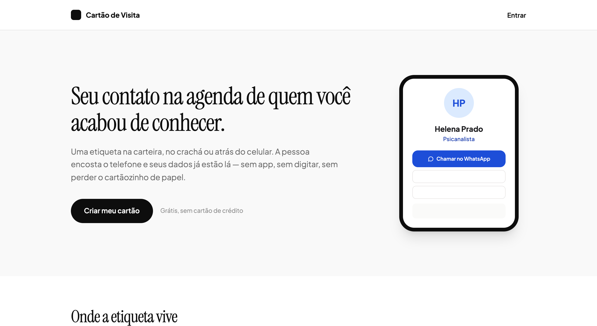
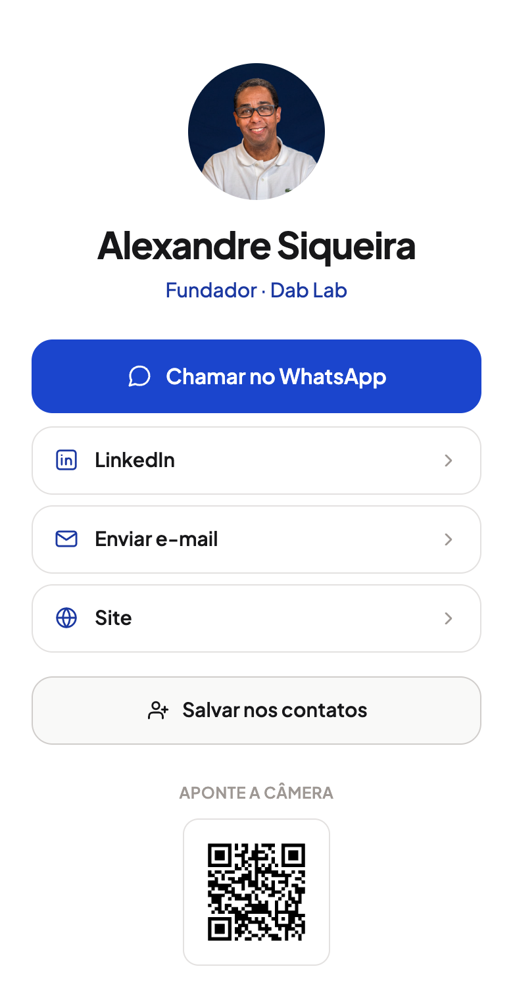
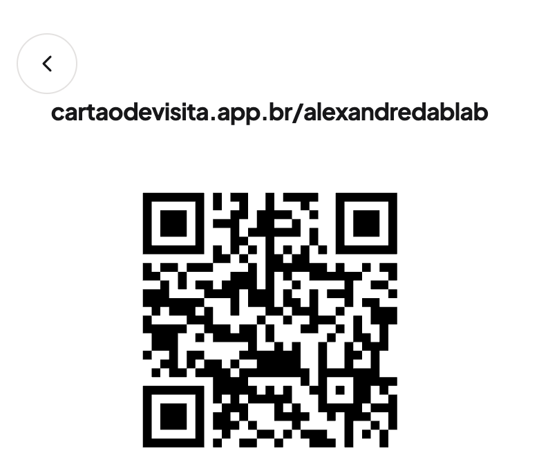
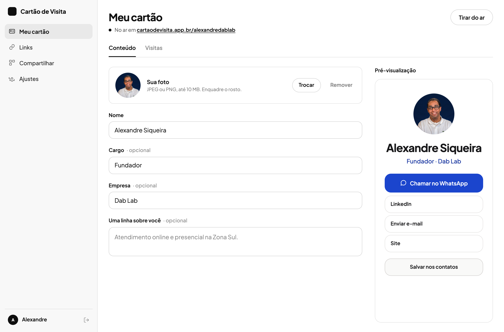
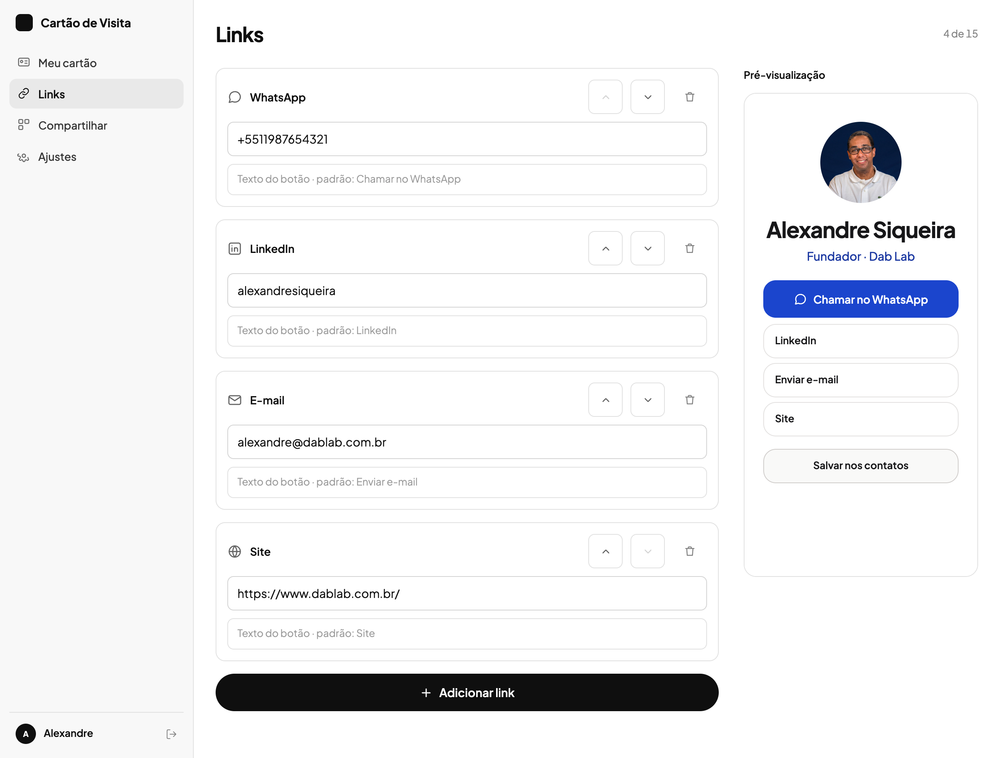
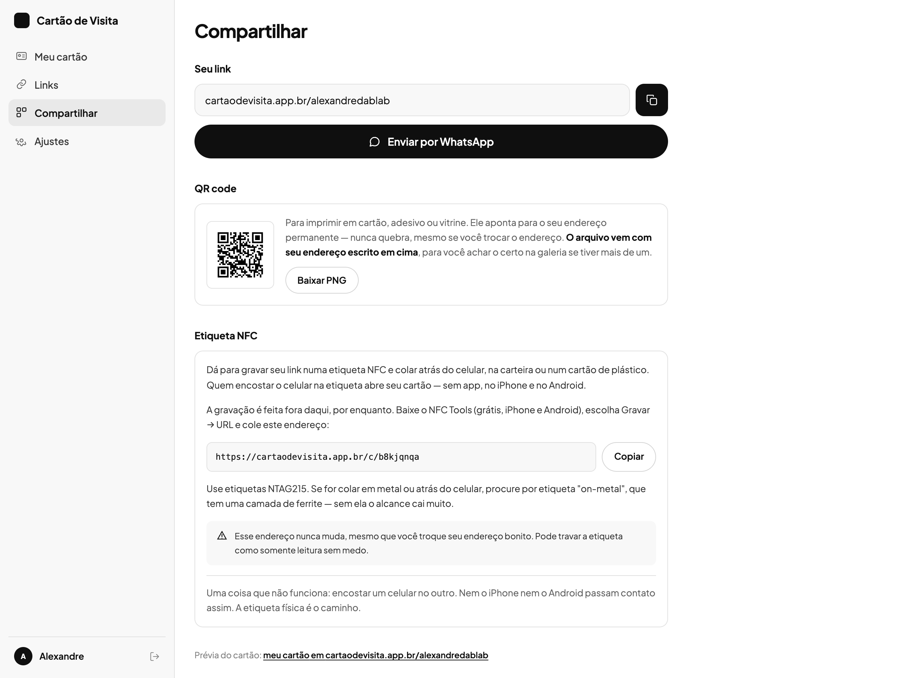

<p align="center">
  
</p>

<p align="center">
  <a href="https://cartaodevisita.app.br"><b>cartaodevisita.app.br</b></a> ·
  <a href="https://cartaodevisita.app.br/termos">Termos de uso</a> ·
  <a href="https://cartaodevisita.app.br/privacidade">Privacidade</a> ·
  <a href="LICENSE">Licença</a>
</p>

O **Cartão de Visita** é um cartão de visitas digital para quem precisa ser encontrado depois: autônomos, times de campo, força de vendas e qualquer pessoa que já ditou o Instagram errado no meio do barulho. Você entra com o Google, monta o cartão com foto, cargo, WhatsApp e links, e ganha um endereço próprio como `cartaodevisita.app.br/seunome`. Quem recebe abre no navegador e salva seu contato na agenda — sem instalar nada e sem criar conta.

O link vai para onde você quiser: numa etiqueta NFC colada no crachá, na capa do celular ou na carteira; num QR code impresso; ou mandado pelo WhatsApp.

É um produto da [Dab Lab](https://www.dablab.com.br/).

## O cartão que a outra pessoa abre

A página pública é renderizada no servidor e funciona em qualquer navegador, sem JavaScript de framework para a pessoa esperar. O botão principal chama no WhatsApp; **Salvar nos contatos** baixa um `.vcf` com a foto embutida, que o iPhone e o Android abrem direto na tela de novo contato. No fim da página, o QR do próprio cartão, para quem está do seu lado apontar a câmera.

<p align="center">
  
  &nbsp;&nbsp;
  
</p>

## O painel

### Meu cartão

Foto, nome, cargo, empresa e uma linha sobre você, com a pré-visualização do cartão ao lado mudando enquanto você digita. O cartão só vai ao ar quando você publica, e o botão **Tirar do ar** desfaz isso a qualquer momento sem apagar nada. A aba **Visitas** mostra quantas pessoas abriram seu cartão nos últimos 30 dias, agregado por dia e por origem — nunca quem entrou.



### Links

Dezesseis tipos de link — WhatsApp, telefone, e-mail, site, Instagram, LinkedIn, YouTube, TikTok, Facebook, X, GitHub, Behance, Spotify, Pix, endereço e um genérico — cada um com o texto de botão que você quiser, na ordem que você quiser. WhatsApp e Pix entram uma vez só. O plano gratuito vai até 5 links; os demais, até 15.



O número de WhatsApp da figura é fictício.

### Compartilhar: link, QR e etiqueta NFC

O link para copiar, o envio por WhatsApp, o QR em PNG para imprimir e o endereço que você grava numa etiqueta NFC. O PNG sai com o seu endereço escrito em cima, para você achar o arquivo certo na galeria depois.



## Dois endereços, e só um vai para a etiqueta

Todo cartão tem dois endereços:

| Endereço | Para quê |
|---|---|
| `/<seunome>` | O bonito. É o que você fala, manda por mensagem e põe na assinatura de e-mail. Pode ser trocado. |
| `/c/<id>` | O permanente. Nasce com a conta e **nunca muda**. É o que vai no QR code e na etiqueta NFC. |

A separação existe por um motivo prático: etiqueta NFC pode ser travada como somente leitura, e QR impresso não se reimprime. Se o endereço bonito fosse gravado neles, trocar de endereço transformaria cada etiqueta e cada cartão impresso em lixo. Com o endereço permanente gravado, você troca o endereço bonito à vontade e tudo que já foi impresso ou gravado continua levando ao seu cartão atualizado.

## Planos

| Plano | Como se chega nele | O que muda |
|---|---|---|
| `gratuito` | Padrão, quando a janela de early adopter está fechada | 5 links e "Feito com Cartão de Visita" no rodapé do cartão |
| `early_adopter` | Toda conta nova enquanto `EARLY_ADOPTER_ABERTO=true`, **para sempre** | 15 links, sem marca no rodapé |
| `ilimitado` | Allowlist de e-mails, conferida a cada login | igual ao early adopter |
| `pago` | Existe no modelo, sem cobrança implementada na v1 | igual ao early adopter |

Fechar a janela de early adopter nunca rebaixa quem já entrou: o plano é lido só no nascimento da conta.

## Stack técnica

- Next.js 15 (App Router), React 19 e TypeScript strict
- Tailwind CSS 4
- Auth.js v5 para o login com Google (sem Firebase no `lib/auth.ts`, para rodar no Edge)
- Cloud Firestore e Cloud Storage pelo Admin SDK, **só no servidor** — as regras de segurança negam todo acesso vindo do navegador
- `qrcode` para gerar os QR codes; vCard 3.0 escrito à mão, com dobra em 75 octetos
- Vitest: suíte unitária e suíte de integração contra o emulador do Firestore
- Visão de Produto para os eventos de uso, só no painel e nunca na página pública
- Hospedagem na Vercel

## Como foi construído

Desenvolvido com o Claude (Anthropic) a partir de uma especificação SDD, escrita antes do código e mantida como fonte única de verdade.

| Arquivo | O que é |
|---|---|
| [`spec.md`](spec.md) | Especificação do produto (fonte única de verdade) |
| [`DOCUMENTACAO-TECNICA.md`](DOCUMENTACAO-TECNICA.md) | O que está implementado de fato, com os bugs encontrados rodando |
| [`CLAUDE.md`](CLAUDE.md) | Guia para sessões do Claude Code neste repositório, com as pegadinhas que não podem ser quebradas |
| [`modelo-cartaodevisita.dbml`](modelo-cartaodevisita.dbml) | Modelo de dados |
| [`prompt-design-cartaodevisita.md`](prompt-design-cartaodevisita.md) | Prompt de design das telas |

Os testes em [`tests/`](tests/) cobrem a lógica pura (handle, ids, links, vCard, QR, planos, publicação, telemetria) e a integração com o emulador. Um deles não testa comportamento: [`tests/estrutura.test.ts`](tests/estrutura.test.ts) varre o código-fonte para garantir as regras de segurança do `CLAUDE.md` — guardas em toda rota de dono, 404 em vez de 403 no admin, nada de Firestore no navegador, QR sempre pelo id permanente e página pública sem telemetria. [`scripts/diagnostico.mjs`](scripts/diagnostico.mjs) confere as regras de segurança publicadas no Firebase contra as do repositório.

## Status

Publicado e em uso. QR, vCard e etiqueta NFC NTAG215 verificados em iPhone e em Android.

## Contribuições

Issues são bem-vindas; pull requests não são aceitos. Veja [CONTRIBUTING.md](CONTRIBUTING.md).

---

# Rodar

```bash
npm install
cp .env.example .env.local   # preencha os valores
npm test                     # suíte unitária, não precisa de credencial
npm run dev
```

Outros comandos: `npm run typecheck`, `npm run lint`, `npm run emu` (emulador do Firestore, exige Java) e `npm run test:emu` (integração, com o emulador no ar).

⚠️ **Nunca rode `npm run build` com o `npm run dev` no ar.** Os dois escrevem em `.next` e o servidor cai com "Cannot find module './vendor-chunks/...'", que não diz o que aconteceu. Use `DIST_DIR=.next-medicao npm run build`.

## Variáveis de ambiente

Todas em [`.env.example`](.env.example). As que precisam de atenção:

| Variável | Observação |
|---|---|
| `EARLY_ADOPTER_ABERTO` | `true` faz conta nova nascer early adopter, para sempre. Lida só na criação da conta; desligar nunca rebaixa quem já entrou |
| `VISAO_API_KEY` | Telemetria do painel. Ausente = desligada, e o app funciona igual |
| `FIREBASE_PRIVATE_KEY` | Secreta. Nunca versionar, nunca com prefixo `NEXT_PUBLIC_` |

Nenhuma credencial vai para o navegador. Variável com `NEXT_PUBLIC_` é pública: não coloque segredo atrás desse prefixo.

## Licença

O código está aberto para leitura e estudo, nos termos do [LICENSE](LICENSE).

Feito pela [Dab Lab](https://www.dablab.com.br/), product studio de software e IA que constrói apps para pequenas empresas, startups e áreas dentro de grandes empresas, partindo de uma especificação (Spec-Driven Development) e com as disciplinas de engenharia de software robusta.
